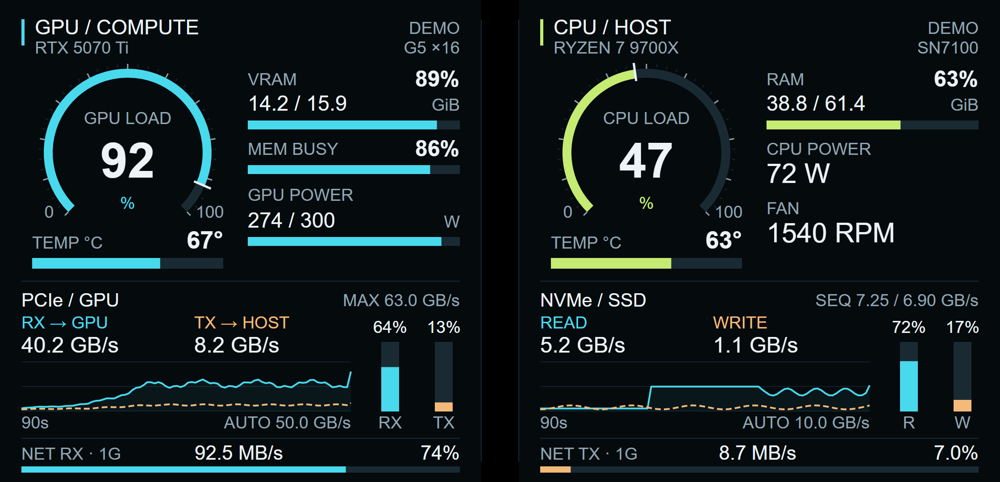

# TRYX AI Dashboard

面向 **TRYX 展域 SE 360 / PANORAMA SE** 的本机硬件仪表盘。通过 USB 将 Windows 实时指标显示到散热器自带屏幕上，适合观察本地 AI 运行时的计算负载、内存容量与数据传输。

双主表盘显示 GPU / CPU 负载，下方显示温度；侧栏显示显存、内存与功耗；底部保留传输曲线，并用条形表显示相对于带宽参照值的占比。只做可视化监控，不含 AI 模型、告警或自动调节功能。



> 图中是设计演示数据。运行时的型号、容量、网速和带宽参照值来自使用者自己的电脑。当前版本为 **v0.4.1**，新增桌面控制台、快捷开关和可选自启动。

## 下载与部署

**适用条件：** Windows 10/11、Python 3.10 或更新版本（推荐 3.12）、已安装且运行的 KANALI、通过 USB 正常连接的兼容屏幕。当前只接受设备型号 `cm01_se`、分辨率 `2240 × 1080`。实体测试覆盖 Windows 11 + 一台 PANORAMA SE；其他固件仍需验证。

1. 从 [Releases](https://github.com/Bsun18/tryx-ai-dashboard/releases/latest) 下载 `tryx-ai-dashboard-v0.4.1.zip`，解压到有写入权限的本地文件夹。也可以使用 GitHub 的 **Code → Download ZIP**。
2. 从 [Python 官网](https://www.python.org/downloads/windows/) 安装 Python，安装时启用 **Add python.exe to PATH**。已安装者可跳过。
3. 打开 KANALI，确认原厂屏幕正常工作。
4. 双击 `setup.cmd`。它会创建项目独立的 Python 环境、安装依赖、识别屏幕和电脑硬件，并创建桌面入口。首次安装需要联网访问 PyPI。
5. 打开桌面的 **TRYX 仪表盘控制台**，点击“启动仪表盘”。也可运行 `control.cmd`。首次读取硬件可能需要约 10–65 秒。
6. 要返回 KANALI 的画面，点击“关闭 · 返回原画面”。桌面 **TRYX 仪表盘开关** 可直接双击切换；原 `start.cmd` / `stop.cmd` 仍可使用。

发布包已包含本项目编译的 `renderer/renderer.jar`，普通使用者**不需要安装 Java 或 Android SDK**。Python 需包含标准 Tcl/Tk 组件。项目不安装 APK、刷写固件或修改风扇曲线。

### 自动启动与日常开关

在控制台勾选 **登录 Windows 后自动启动**，以后登录当前用户时会静默启动。取消勾选即可禁用；安装时默认不启用此选项。它是用户登录启动项，不是登录前的系统服务，不需要保存密码。

- 关闭控制台窗口不影响仪表盘运行。
- 手动关闭仪表盘后，本次登录不会被后台监督程序重新打开；仍勾选自启动时，下次登录会恢复。
- USB 设备枚举较慢时采集器会等待并重试，不会因为开机时尚未发现屏幕而直接退出。
- 已有且可访问的 `StartKANALI` 厂商任务会被复用；只有任务指向实际存在的 `KANALI.exe` 才会调用，不新增高权限任务。没有此任务时，请在 KANALI 自己的设置中启用自启动，或手动打开 KANALI。
- 自启动项为当前用户启动文件夹中的 `TRYX AI Dashboard.lnk`。应用也会识别任务管理器中对它的禁用。
- 升级建议解压到原项目目录并保留 `config.json`。若改用另一个目录，先在旧控制台取消自启动、停止旧实例并删除旧桌面快捷方式，再在新目录安装；不同目录不会互相接管快捷方式或进程。

首次配置完成后不再需要联网下载依赖，运行时不上传遥测数据。保持 KANALI 运行，以提供 CPU 温度、功耗和风扇数据。安装位置变化、重装 Python 或迁移到另一台电脑时，应使用干净的发布包重新运行 `setup.cmd`，不要复制旧电脑的 `.venv` 和 `runtime`。

## TRYX 其他屏幕能否使用

**目前正式支持的配置仍是 `cm01_se`、`2240×1080`，实体确认来自 PANORAMA SE 360。** 普通 PANORAMA / ARGB 的规格相近，具有适配潜力，但当前版本不会直接对其部署。PANORAMA SE V2、STAGE、TURRIS 等尚未验证，不能因使用 KANALI 就认定其通信协议、Android 权限和屏幕布局一致。详细型号比较及官方来源见 [兼容性说明](docs/compatibility.md#同品牌其他屏幕)。

其他型号可运行 `diagnose-screen.cmd`，生成 `runtime/screen-diagnostic.json`：仅查询 ADB 型号、Android 版本和分辨率，不上传 DEX、建立转发、截图或修改画面。报告不包含 ADB 序列号、用户名或本机路径。若 `setup.cmd` 在型号检查阶段失败，已经创建的 Python 环境仍可运行此诊断。

`matches_current_profile` 只表示型号/分辨率符合当前配置，不代表已经验证该固件的绘图权限。报告可用于后续适配；暂无 ADB 接口的屏幕需要另一套传输方案。

## 自动读取哪些参数

| 项目 | 自动行为 |
| --- | --- |
| 屏幕 | 从 ADB 设备中识别 `cm01_se`，检查分辨率；忽略普通手机 |
| CPU | 读取本机型号、总负载；温度与功耗取自 KANALI 新鲜传感器数据 |
| GPU | 默认读取 NVML 的第 0 张 NVIDIA 显卡，包括型号、负载、显存、功耗及 PCIe 指标 |
| 其他显卡 | NVML 不可用时，使用 KANALI 的 GPU 负载、温度、功耗；显存和 PCIe 等缺失项显示 `—` |
| 内存 | 读取实际 RAM 总容量、使用量与占比 |
| SSD | 优先内置 NVMe，其次系统盘，再按磁盘编号选择；不写死 Disk 0 或某个型号 |
| SSD 带宽 | 读取 NVMe 控制器报告的 PCIe 最大代际和通道数，计算单方向链路容量，标记 `LINK` |
| 网络 | 优先使用默认 IPv4 路由对应的活动物理网卡，否则选择报告速率最高的活动物理网卡 |
| 网络带宽 | 使用网卡报告的当前链路速率，而不是产品宣传速率或宽带套餐速率 |

**参照占比不等于确定的“瓶颈判定”。** SSD 的 `LINK` 是接口容量，可能明显高于 SSD 自身持续读写能力；GPU 的 `MAX` 是设备报告的最大 PCIe 能力。协议开销、上游链路、队列、访问方式与温度等都会影响真实吞吐。缺少可靠参照值时保留实时速率和曲线，占比显示 `—`，不会猜测峰值。详细定义见 [指标说明](docs/metrics.md)。

## 可选配置

通常无需手工修改。`setup.cmd` 会生成本地 `config.json`，各项 `null` 表示自动识别。修改后先停止再启动。

```json
{
  "device_serial": null,
  "adb_path": null,
  "gpu_index": 0,
  "disk_index": null,
  "network_interface": null,
  "gpu_label": null,
  "cpu_label": null,
  "storage_label": null,
  "storage_read_peak_mb_s": null,
  "storage_write_peak_mb_s": null
}
```

| 字段 | 用途 |
| --- | --- |
| `device_serial` | 多台兼容屏幕时，指定目标 ADB 序列号；仅保存在本地 |
| `adb_path` | 指定自己的 `adb.exe` 完整路径，例如 `D:/Android/platform-tools/adb.exe` |
| `gpu_index` | NVIDIA NVML 显卡索引，从 0 开始；不控制 KANALI 的 GPU 选择 |
| `disk_index` | Windows 物理磁盘编号，如 2；显式选择不存在的磁盘时显示缺失，不改选其他磁盘 |
| `network_interface` | Windows 网卡名称；指定网卡断开时显示缺失，不自动切换 |
| `*_label` | 自定义屏幕短名称，过长会截断；不改变被采集的硬件 |
| `storage_*_peak_mb_s` | 可选的 SSD 读/写参照速度，十进制 MB/s；设置后标记 `REF`，未设置的方向保持未知 |

硬件清单保存在本地 `runtime/hardware.json`，用于确认选中的磁盘编号和网卡名称。它与 `config.json`、日志和设备序列号均被版本控制忽略，不包含在官方发布包里。多显卡电脑使用 KANALI 回退时，其 GPU 选择由 KANALI 决定；程序不能保证对应 `gpu_index`。

## 常见问题

- **提示找不到 ADB：** 优先使用项目 `tools/platform-tools/adb.exe`、`tools/adb.exe`、PATH 或 Android SDK 的 ADB；也会尝试复用默认安装目录中的 KANALI ADB。非默认 KANALI 安装位置可通过 `adb_path` 指定。仍找不到时，从 [Google 官方 Platform-Tools](https://developer.android.com/tools/releases/platform-tools) 下载，接受其条款后解压到项目 `tools` 目录。不要从不明网站下载 DLL。
- **未发现兼容屏幕：** 检查 KANALI 是否识别设备、USB 接线、驱动及固件。其他型号/分辨率会被拒绝，本版本不能保证兼容 PANORAMA 非 SE 或其他品牌屏幕。
- **温度、功耗或风扇显示 `—`：** KANALI 未持续提供对应传感器数据，或固件日志格式与已测试版本不同。保持 KANALI 运行；程序不安装额外传感器驱动。
- **AMD / Intel 显卡信息不完整：** 当前只为 NVIDIA 实现了 NVML 完整采集路径。KANALI 回退为部分支持，见 [兼容性说明](docs/compatibility.md)。
- **提示端口 18765 被占用：** 先停止旧目录中的仪表盘，再启动新版本；同一台电脑一次运行一个实例。程序不会停止另一份安装目录的采集器。
- **启动后显示等待：** 检查 `runtime/usb-status.json`；无设备、多设备歧义或不支持的型号会保留说明并持续等待，不会强行部署。
- **启动未确认：** 查看 `runtime/launcher-error.log`、`runtime/collector.log` 和 `runtime/renderer.log`。控制台错误另见 `runtime/control-error.log`。日志可能包含本机信息，提交 issue 前先检查并删去序列号、用户名及路径。
- **USB 断开或休眠：** 数据失效后显示 `NO DATA`，约 15 秒释放叠加画面；连接恢复后后台采集器会尝试重建。此路径仍需在不同电脑上验证。
- **想更换监控磁盘/网卡：** 修改本地配置后重启采集器。磁盘清单与型号在启动时读取，USB 网卡等新增设备也建议重启重新识别。

## 开发与验证

Windows 负责 Python 采集和本地 HTTP 服务（仅 `127.0.0.1:18765`），ADB USB 反向端口将数据交给屏幕上的 Android 原生 Canvas 渲染器。渲染器使用暂时的 SurfaceControl 叠加层，停止后原厂画面重新可见。

```text
Windows sensors / NVML / KANALI
            → Python collector → loopback HTTP
            → ADB USB reverse → Android Canvas → cooler screen
```

运行硬件无关测试：

```powershell
.venv/Scripts/python.exe -m unittest discover -s tests -v
```

重新编译渲染器需要 JDK 17、Android SDK Platform 30 和 Build-Tools 34。设置 `JAVA_HOME`、`ANDROID_HOME` 后执行：

```powershell
python scripts/build_renderer.py
```

也可显式传入 `--java-home`、`--sdk-root`、`--platform android-30`、`--build-tools-dir`。编译产物只有 DEX 渲染代码，不包含 Android SDK、JDK 或厂商程序。CI 验证 Python 3.10 / 3.12 的硬件无关逻辑；真实 USB、驱动和固件兼容性不能由 CI 代替。

## 项目范围与依赖

这是独立的社区项目，与 TRYX / KANALI 无官方关联。当前公开提供下载、配置和在自己的电脑上部署使用；暂未声明通用开源许可证。第三方依赖仍适用各自条款，见 [THIRD_PARTY_NOTICES](THIRD_PARTY_NOTICES.md)。

不随项目分发厂商 ADB/DLL、显卡驱动、用户配置或原始设备日志。发布包包含源代码，方便检查参数来源和显示逻辑。
